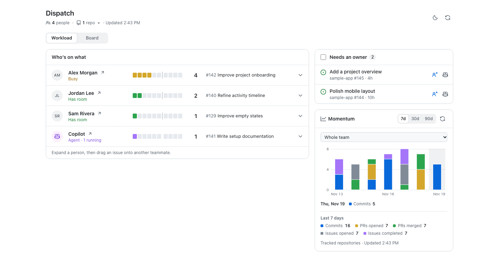
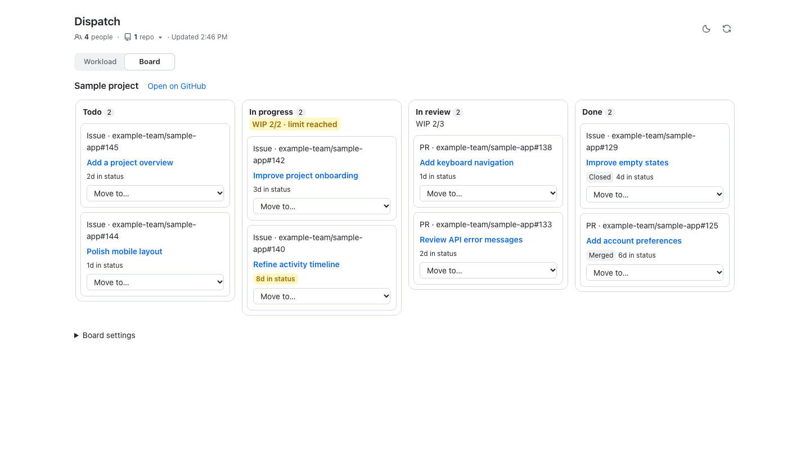

# Dispatch canvas

Dispatch is a GitHub Copilot app canvas for coordinating work across repositories. **Workload** shows teammates' and the Copilot coding agent's open work, unassigned issues, and activity; **Board** organizes issues and pull requests by the Status field of a shared GitHub Project. Assign work, open item details, or move Board cards without leaving the canvas.

Dispatch is a user-scope extension in `~/.copilot/extensions/dispatch/`, based on [tinyclips-team-load](https://github.com/jamesmontemagno/tiny-clips/tree/main/.github/extensions/tinyclips-team-load). Choose repositories in the canvas; the team is derived from those repositories. See [TODO.md](TODO.md) for planned work and follow-ups.



*Screenshot uses fictional people and repository data.*

Use the sun/moon button beside Refresh to switch between light and dark themes. The canvas follows the system theme until you choose one; your choice applies to every view until the page reloads.

## Install

Clone the repo as a user-scope extension, then reload extensions in the Copilot app:

```bash
git clone https://github.com/soderlind/copilot-dispatch-canvas ~/.copilot/extensions/dispatch
```

The folder name must be `dispatch` and the entry file is `extension.mjs`. It needs the `gh` CLI, signed in (`gh auth login`). Per-user tracking is written to `artifacts/` and is git-ignored.

## What it shows

- **Who's on what**: one row per tracked person. The row shows a load meter (open assigned issues + authored PRs + review requests, with a limit marker), a status label (Free / Has room / Busy / At limit / N over limit), and their most recent item. Expand a row to see every item, with up to two label pills (+N for the rest; hidden on narrow panels). The arrow icon beside a name opens that person's profile.
- **Move an issue**: expand a person on the home screen, then drag an issue onto another teammate's row (including Copilot). This removes only the source person's assignment, keeps any other assignees, and offers Undo. PRs and reviews cannot be dragged. For a keyboard move, focus an issue and press Space, Tab to the target person's name button, and press Enter; Escape cancels.
- **Needs an owner**: open, unassigned issues in the tracked repos, each with one-click assign to a person or to Copilot.
- **Bulk local sessions**: tick issues in Needs an owner (or in an expanded person's list; the checkbox appears over the issue icon on hover), or use the select-all box, then **Start N Copilot sessions**. Up to 10 at a time. This does not assign the Copilot coding agent on GitHub; it assigns you and asks the hosting conversation to start one local Copilot coding session per issue. Those rows swap their issue icon for an animated Copilot icon ("Copilot session starting") for a few minutes. Escape clears the selection.
- **Momentum**: daily commits, PRs opened and merged, and issues opened and completed across the tracked repos, drawn in the load-meter palette. It shows 7 days by default (or 30 / 90), for the whole team, one person or everyone, across all repos or just one. Hover a day for its numbers; the play button replays the animation. Days are UTC.
- **Board**: a kanban view of issues and PRs in a shared GitHub Project. Drag a card or use its **Move to…** menu. Click the title to open its in-canvas detail.
- **Person profile** (`#person/<login>`): that person's Momentum over time, plus everything currently assigned to them and an Open on GitHub link. Copilot has a profile too. Contributions cover the tracked repos only, not their GitHub-wide activity.
- Clicking any issue or PR opens it inside the canvas. You get the title, state, labels, assignees, the rendered body and the latest comments, plus Back and Open on GitHub. In tracked repos the view is editable: add or remove assignees (Copilot only on issues), toggle labels from the gear menu, post a Markdown comment (Cmd/Ctrl+Enter), delete your own comments, and close or reopen the issue or PR ("Close with comment" when there's a draft). Drafts survive refreshes and navigation until the page reloads.

## Actions (real GitHub writes)

| Action | How |
| --- | --- |
| Assign to a person | `gh issue edit N --repo o/r --add-assignee <login>`, re-read to verify |
| Assign to Copilot | `gh issue edit N --repo o/r --add-assignee @copilot` (starts the coding agent) |
| Add to an assigned issue | the same writes with `additional: true`; does nothing if the person is already on the issue |
| Remove an assignee | `gh issue edit N --repo o/r --remove-assignee <login>`, re-read to verify |
| Move to another person | `reassign` with `repository`, `number`, `from` and target `login`; adds and verifies the new owner before removing the source, without replacing the full assignee list |
| Start a session myself | assigns you, then `session.send({ prompt })` to the hosting conversation; rolls back the assignment if sending fails. It only rolls back an assignment it made itself. |
| Start sessions (bulk) | `start_sessions` with `items[]`: assigns you to each issue, then one `session.send({ prompt })` listing every issue (repo, number, title, URL) and asking for one local Copilot coding session each. If a claim or the send fails, it rolls back new assignments, including the current claim when its write response or verification read fails. Existing assignments are preserved; an unverified rollback reports which issue to check on GitHub. |
| Comment | `gh api POST repos/o/r/issues/N/comments` (body over stdin); Undo deletes it |
| Delete a comment | `gh api DELETE repos/o/r/issues/comments/ID`, only your own and only on the item shown |
| Labels | `gh api POST/DELETE repos/o/r/issues/N/labels`; only labels that already exist in the repo, re-read to verify. The picker fetches all label pages (up to 1,000, with an explicit error above that limit); Undo targets the original issue even after navigation. |
| Close / reopen | `gh issue\|pr close\|reopen N --repo o/r`, re-read to verify; merged PRs can't be reopened |
| PR assignees | `gh api POST/DELETE repos/o/r/issues/N/assignees` (people only, not Copilot) |
| Undo | reverses the last change: removes someone you just added, or puts back someone you just removed |

Before writing, it checks for conflicts: the issue is closed or a PR. Without `additional`, an already-assigned issue is also a conflict, which keeps Needs an owner a safe triage action; adding to an assigned issue is an explicit choice made from the issue's Assignees list. After each write it refreshes.

Moving also verifies that the source still owns the issue. If the target cannot be assigned, the source is not removed. If removing the source fails, the partial change is reported explicitly and the canvas refreshes; it never reports a successful move without verifying both assignments. Undo preserves a target who was already a co-assignee.

## Board setup

The Board uses your **stored `gh` login**, ignoring `GH_TOKEN` and `GITHUB_TOKEN` (the Copilot app injects a `GH_TOKEN` that cannot gain new scopes). Workload keeps using the environment token. The stored login needs the **write `project` scope** in addition to repository access.

When the scope is missing, the Board shows **Grant Project access**. It runs `gh auth refresh -h github.com -s project` in the background, shows the one-time code (also copied to your clipboard) with a link to `github.com/login/device`, and reloads the Board once you approve. Your existing scopes are kept. You can also run the command yourself in a terminal. If `gh` has no stored login, run `gh auth login` first. For organization Projects, check SSO authorization and Project write access as well.

Open **Board** and link an editable GitHub Project with a single-select `Status` field. The canvas checks the tracked repo owners and the signed-in user's Projects. Reuse an existing Project if it fits your repos. If none of the listed Projects fit, choose to create one under the common repo owner, or choose an owner when repos have different owners. Creation requires explicit confirmation. Each global or Copilot Project tracking scope stores its own link and Board settings.



*Board screenshot uses fictional project and repository data.*

Existing Project cards appear as soon as the Project is read; the Board syncs open issues and PRs from tracked repos in the background and shows a sync notice. Refresh adds new open work automatically while the canvas is active. Status ages are also fetched in the background with bounded concurrency. Untracking a repo hides its cards without removing anything from the GitHub Project. Moving a card changes only its Project Status. Closed and merged work stays in the status GitHub reports and gets a badge; workflows configured in GitHub can still change or archive items independently. If an Iteration field exists, the Board shows its values but never manages sprints.

In **Board settings**, leave WIP limits blank to disable them. Limits count open, unarchived cards and warn at or above the limit without blocking moves. Cards are highlighted after seven days in status by default. Age comes from GitHub's status-change timeline; if the exact date can't be established, the card says **Status age unavailable**.

## Data

Everything is fetched live with the GitHub CLI (`gh`, must be signed in). Repos are fetched through GraphQL with pagination, at most 3 concurrent requests, and one retry for transient read errors. Profiles are cached and coalesced. A failing repo shows a warning without breaking the rest of the view. Auto-refresh runs every `refreshSeconds` (minimum 60) while the canvas is visible.

Momentum is history, so it is cached separately: each repo's activity is fetched once and reused for up to an hour, and a 30 or 90 day fetch also serves the shorter ranges. It is refetched only when the canvas needs it and the cache has aged out, never on its own timer. Only the Momentum card's refresh button forces a refetch; the app-wide refresh, auto-refresh, switching ranges and opening a profile all reuse the cache. If a refetch fails, the last good data for the same selection is shown and marked stale. Changing the person, repository, range, or tracked people/repos clears the previous selection's chart and supersedes its in-flight requests, so a failed load cannot show another selection's totals. The cache lives in memory, so reloading the extension starts it fresh.

Agents can read the same data with the `get_momentum` action (`days` 7/30/90, defaulting to 7; optional `person`, `everyone`, `repository` and `force`).

## Tracking

Open the **Tracking** panel from the people · repos button in the header.

- **Repos tab**: tick repos to track (up to 15). The list offers your recently pushed repos and every repo you've tracked before. Type `owner/name` to add any repo, or `owner/prefix*` to add every matching repo (for example `soderlind/vmfa*`).
- **People tab**: the team is derived from the tracked repos. It includes everyone who can be assigned there (plus Copilot where it's enabled) and anyone already assigned to open work. You can't add people directly. Untick someone to hide them, for example a bot or a former teammate.

Agents can do the same with `set_tracking`: `{ "repos": ["owner/name", "owner/prefix*"], "hidden": ["login"] }`. Either list may be omitted to keep it as is.

Tracking is saved to `$COPILOT_HOME/extensions/dispatch/artifacts/tracking.json` (default `~/.copilot/...`). It also accepts two optional hand-edited settings, which are kept across saves:

- `limit`: the load-meter limit, 1-20. Default 6.
- `refreshSeconds`: the auto-refresh interval, at least 60. Default 300.

Delete the file to start over.

### In a Copilot Project

When the canvas is opened in a persistent Project (under **Projects** in the app), it tracks that Project's repositories:

- **Where the repos come from**: the repos selected when the Project was created, plus every repo the Project later adds with `add_repository`. They are read from the Project session's own history (`session-state/<id>/events.jsonl`, falling back to the SDK's `session.getEvents()`), and new additions are picked up live while the canvas is open.
- **Own tracking file**: each Project gets its own file, `artifacts/projects/<project-session-id>.json`. It starts with the global hidden people and known repos, and it always uses the global `limit` and `refreshSeconds`. Changes in a Project never affect the global tracking or other Projects.
- **Added once**: each Project repo is added only once. If you stop tracking one, it stays off, but repos the Project adds later are still picked up. If a Project has more than 15 repos, the first 15 are tracked and the rest are offered in the picker.

Detection relies on how the Copilot app records Project sessions, so it is best effort. If it can't tell, the canvas falls back to the global tracking, and you can still choose repos yourself or with `set_tracking`.

## Security

The canvas is served from a loopback server with a per-launch nonce, a host/origin check and a strict CSP (no inline script or style). Issue and comment HTML is sanitized client-side against an allowlist before rendering.

## Development

```bash
cd ~/.copilot/extensions/dispatch && node --test tests/
```

Tests mock `gh`; they never touch GitHub. Client request-state tests use minimal DOM fixtures and deferred responses to cover bulk controls, navigation during edits, label Undo, Momentum selection changes, tracking races, and same-selection stale-data fallback without browser dependencies. Project detection is tested against fixture `events.jsonl` files.

The optional Board browser regression uses Playwright and the real loopback server with a stubbed GitHub adapter. Run `npm ci` and `npx playwright install chromium` once, then run `node --test tests/board-browser.mjs`. Set `PLAYWRIGHT_CHROME_CHANNEL=chrome` to use an installed Google Chrome instead.

See [CHANGELOG.md](CHANGELOG.md) for recent changes and [TODO.md](TODO.md) for planned work.

## License

[MIT](LICENSE). Based on [tinyclips-team-load](https://github.com/jamesmontemagno/tiny-clips/tree/main/.github/extensions/tinyclips-team-load) by James Montemagno (MIT).

## AI contribution attribution

Parts of this extension were developed with AI assistance. Contributions made with AI tools carry an `Assisted-by` tag:

```
Assisted-by: AGENT_NAME:MODEL_VERSION [TOOL1] [TOOL2]
```

`AGENT_NAME` is the AI tool, `MODEL_VERSION` the model, and the optional tools are specialized analysis tools (basic tools such as git or editors are not listed). For this extension:

```
Assisted-by: GitHub Copilot:auto
```
